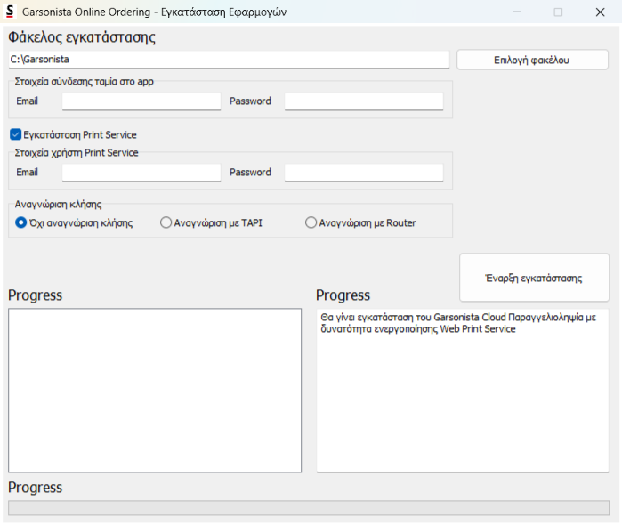

# Εγχειρίδιο — Εγκατάσταση Garsonista Online Παραγγελιοληψία

> Πώς εγκαθίσταται στο PC του καταστήματος το **Garsonista Online
> Παραγγελιοληψία** — ισχύει και για τις δύο εκδόσεις:
>
> - **Cloud Ταμειακή**
> - **Παραγγελιοληψία με Web Print Service**
>
> Ο ίδιος installer καλύπτει και τις δύο: εγκαθιστά το Garsonista Cloud
> Παραγγελιοληψία **με δυνατότητα ενεργοποίησης Web Print Service**.
> Η εγκατάσταση είναι υπόθεση 2-3 λεπτών και ουσιαστικά ενός κουμπιού.

---

## 1. Τι θα χρειαστείς

- PC με **Windows** (το PC όπου θα δουλεύει η παραγγελιοληψία — και, για την
  έκδοση με Web Print Service, εκεί όπου θα «κουμπώσουν» οι εκτυπωτές).
- Δικαιώματα **διαχειριστή** στο PC (η εκτέλεση γίνεται «ως διαχειριστής»).
- Σύνδεση στο internet.

---

## 2. Κατέβασμα του installer

Κατέβασε το αρχείο **Garsonista_installer.zip** από εδώ:

**➜ [Garsonista_installer.zip](https://github.com/semantic-software/garsonista_user_manuals/releases/download/installer/Garsonista_installer.zip)**

Το zip περιέχει το πρόγραμμα εγκατάστασης **SemanticInstaller.exe** (μαζί με
τα απαραίτητα συνοδευτικά αρχεία του).

---

## 3. Βήματα εγκατάστασης

1. **Αποσυμπίεσε** το `Garsonista_installer.zip` **οπουδήποτε** (π.χ. στην
   Επιφάνεια εργασίας ή στις Λήψεις) — δεξί κλικ → «Εξαγωγή όλων…».
2. Μέσα στον φάκελο που βγήκε, κάνε **δεξί κλικ στο `SemanticInstaller.exe`**
   και επίλεξε **«Εκτέλεση ως διαχειριστής»**.
3. Ανοίγει το παράθυρο **«Garsonista Online Ordering — Εγκατάσταση
   Εφαρμογών»**:
   - **«Φάκελος εγκατάστασης»**: προτεινόμενος ο `C:\Garsonista` — άφησέ τον
     ως έχει (ή άλλαξέ τον με το κουμπί **«Επιλογή φακέλου»** αν χρειάζεται).
   - **«Στοιχεία σύνδεσης ταμία στο app»** (προαιρετικό): «Email» και
     «Password» του χρήστη που θα δουλεύει **πάντα** σε αυτό το PC (π.χ.
     «Ταμείο 1»). Αν τα συμπληρώσεις, η εφαρμογή θα ξανασυνδέεται μόνη της
     όταν λήξει η σύνδεση (αυτόματη επανασύνδεση — δες την παρατήρηση στην §4).
     **Άφησέ τα κενά** σε PC όπου αλλάζουν χρήστες.
   - **«Εγκατάσταση Print Service»**: τσέκαρέ το όταν σε αυτό το PC θα τρέχουν
     οι εκτυπώσεις του **Web Print Service**. Μόλις το τσεκάρεις εμφανίζεται από
     κάτω το **«Στοιχεία χρήστη Print Service»** με «Email» και «Password» του
     χρήστη του Web Print Service — δεν είναι υποχρεωτικά (αν μείνουν κενά,
     συνδέεσαι χειροκίνητα την πρώτη φορά). Τι ακριβώς στήνει: §3.1.
   - **«Αναγνώριση κλήσης»**: «Όχι αναγνώριση κλήσης», «Αναγνώριση με TAPI»
     (τηλεφωνικό κέντρο) ή «Αναγνώριση με Router» (Fritzbox / Oxygen) — δες
     §3.2.
   - Στο δεξί πλαίσιο Progress γράφει τι θα γίνει: «Θα γίνει εγκατάσταση του
     Garsonista Cloud Παραγγελιοληψία με δυνατότητα ενεργοποίησης Web Print
     Service».
4. Πάτησε **«Έναρξη εγκατάστασης»**:

   

5. Περίμενε να ολοκληρωθεί η πρόοδος (τα πλαίσια Progress γεμίζουν με τα
   βήματα/αρχεία). Αυτό ήταν — η εγκατάσταση ολοκληρώθηκε. Στην επιφάνεια
   εργασίας υπάρχει η συντόμευση **«Garsonista»** (και, ανάλογα με τις
   επιλογές σου, **«Print Service»**, **«TapiCallerID»** ή **«PhoneCalls»**).

### 3.1 Τι κάνει το «Εγκατάσταση Print Service»

Στήνει στο ίδιο PC **δεύτερο, ξεχωριστό** Garsonista μόνο για τις εκτυπώσεις,
ώστε το ταμείο και το Web Print Service να δουλεύουν παράλληλα:

- Φτιάχνει τον φάκελο **`garsonista_app_print_service`** μέσα στον φάκελο
  εγκατάστασης (δίπλα στο `garsonista_app` του ταμείου). Το αντίγραφο **δεν
  παίρνει** τη σύνδεση ούτε τα στοιχεία του ταμία.
- Το ρυθμίζει να τρέχει **κρυμμένο στο εικονίδιο δίπλα στο ρολόι** — βλ.
  [WEB_PRINT_SERVICE.md](WEB_PRINT_SERVICE.md) §2.7. Αν έδωσες «Στοιχεία
  χρήστη Print Service», συνδέεται και ξανασυνδέεται μόνο του (§2.8 του ίδιου
  εγχειριδίου).
- Φτιάχνει συντόμευση **«Print Service»** στην **επιφάνεια εργασίας** και στην
  **εκκίνηση των Windows**, ώστε να ανοίγει μόνο του σε κάθε άνοιγμα του PC.

> Επειδή τρέχει στο εικονίδιο δίπλα στο ρολόι, το **X δεν κλείνει** το Print
> Service — για να κλείσει: δεξί κλικ στο εικονίδιο → **«Έξοδος»**.

Η **ενεργοποίηση** του Web Print Service στο adminpanel γίνεται ξεχωριστά (§4).

### 3.2 Αναγνώριση κλήσης από τον installer

| Επιλογή | Τι κάνει ο installer |
|---|---|
| «Όχι αναγνώριση κλήσης» | Τίποτα. |
| «Αναγνώριση με TAPI» | Συντόμευση **«TapiCallerID»** στην επιφάνεια εργασίας και στην εκκίνηση των Windows. |
| «Αναγνώριση με Router» | Συντόμευση **«PhoneCalls»** στην επιφάνεια εργασίας και στην εκκίνηση των Windows. |

- Αν τσέκαρες και **«Εγκατάσταση Print Service»**, οι συντομεύσεις δείχνουν
  στο πρόγραμμα αναγνώρισης του φακέλου του **Print Service**· αλλιώς στου
  ταμείου (`garsonista_app`).
- Ο installer φτιάχνει **μόνο τις συντομεύσεις**. Οι υπόλοιπες ρυθμίσεις
  (ενεργοποίηση στο adminpanel, Fritzbox / IP router / αριθμός σταθερού,
  driver του τηλεφωνικού κέντρου, παράθυρο του TapiCallerID) γίνονται όπως στο
  εγχειρίδιο [CALLER_ID.md](CALLER_ID.md) — το βήμα της συντόμευσης εκεί το
  παραλείπεις.
- Αν το πρόγραμμα αναγνώρισης δεν υπάρχει στον φάκελο, ο installer βγάζει
  μήνυμα **«Δεν βρέθηκε το αρχείο …»** και δεν φτιάχνει τη συντόμευση — δες
  §5.

---

## 4. Μετά την εγκατάσταση

- **Cloud Ταμειακή**: άνοιξε την εφαρμογή και συνδέσου με τα στοιχεία του
  καταστήματος που έχει δώσει η Garsonista. Για να τυπώνει αποδείξεις, πρέπει
  να εγκατασταθεί στο PC ο driver του θερμικού εκτυπωτή (**TP80K** — HPRT και
  κλασικοί POS80) και να δηλωθεί ο εκτυπωτής στο Garsonista — δες αναλυτικά,
  βήμα-βήμα με εικόνες, το εγχειρίδιο
  [PRINTER_DRIVER_TP80K.md](PRINTER_DRIVER_TP80K.md).
- **Εκτυπωτές δικτύου — γρήγορος τρόπος [ΤΕΧΝΙΚΟΣ]:** αν οι εκτυπωτές έχουν ήδη δηλωθεί στο **Διαχειριστικό →
  Εκτυπωτές** με «Όνομα εκτυπωτή Windows» και IP, στο Garsonista Windows app πάτησε **«Ρυθμίσεις» → «Εγκατάσταση
  εκτυπωτών καταστήματος (Windows)...»**: εγκαθιστά όλους τους εκτυπωτές μαζί (driver TP80K), γράφει το
  `defparams.txt` και, αν χρειάζεται, δίνει στον υπολογιστή IP στο δίκτυο των εκτυπωτών. Μένουν μόνο οι ρυθμίσεις
  χαρτιού — δες [PRINTER_DRIVER_TP80K.md](PRINTER_DRIVER_TP80K.md) §2α.
- **Παραγγελιοληψία με Web Print Service**: η **ενεργοποίηση** του Web Print
  Service γίνεται από τον admin (τεχνικό Garsonista) στο adminpanel,
  επιλέγοντας τον χρήστη που θα είναι συνδεδεμένος στην εφαρμογή — δες
  αναλυτικά το εγχειρίδιο
  [WEB_PRINT_SERVICE.md](WEB_PRINT_SERVICE.md).
- Αν το κατάστημα θα έχει και **αναγνώριση κλήσεων**, το στήσιμο γίνεται στο
  ίδιο PC — δες το εγχειρίδιο [CALLER_ID.md](CALLER_ID.md).

> **Παρατήρηση — αυτόματη επανασύνδεση (relogin) [ΤΕΧΝΙΚΟΣ].** Το Garsonista
> Windows app μπορεί να **ξανασυνδέεται μόνο του** όταν λήξει η σύνδεση και η σελίδα
> γυρίσει στη φόρμα σύνδεσης: γράφεις μία φορά το όνομα χρήστη και τον κωδικό στις
> γραμμές `email=` / `password=` του `defparams.txt` (φάκελος εγκατάστασης), ξανανοίγεις
> το πρόγραμμα, και αυτό τα φυλάει κρυπτογραφημένα και τα σβήνει από το `defparams.txt`.
> Σε νέα εγκατάσταση τα γράφει ο ίδιος ο installer από τα «Στοιχεία σύνδεσης ταμία στο
> app» (§3).
> Δεν αφορά μόνο το PC του Web Print Service: βολεύει σε **κάθε PC ταμείου που μένει
> πάντα συνδεδεμένο με τον ίδιο χρήστη** (π.χ. «Ταμείο 1» στο ίδιο PC κάθε μέρα), ώστε
> το προσωπικό να μη χρειάζεται να ξαναβάζει κωδικό όταν λήγει η σύνδεση. **Μην** το
> βάλεις σε PC όπου αλλάζουν χρήστες (ο ένας αποσυνδέεται για να μπει ο άλλος), γιατί
> μετά από αποσύνδεση το πρόγραμμα ξαναμπαίνει μόνο του με τον ίδιο χρήστη. Ο χρήστης
> μπορεί πάντα να συνδεθεί κανονικά και από άλλα μηχανήματα. Αναλυτικά βήματα, αλλαγή
> κωδικού και κατάργηση: [WEB_PRINT_SERVICE.md](WEB_PRINT_SERVICE.md) §2.8.

---

## 5. Συχνά προβλήματα & λύσεις

| Σύμπτωμα | Αιτία | Λύση |
|---|---|---|
| Τα Windows εμφανίζουν μπλε προειδοποίηση SmartScreen στο άνοιγμα | Προστασία των Windows για προγράμματα εκτός Store | Πάτησε «Περισσότερες πληροφορίες» → «Εκτέλεση όπως και να 'χει» |
| «Δεν έχετε δικαιώματα» / η εγκατάσταση αποτυγχάνει στη μέση | Δεν έτρεξε ως διαχειριστής | Κλείσε το παράθυρο και ξανατρέξε το `SemanticInstaller.exe` με **δεξί κλικ → «Εκτέλεση ως διαχειριστής»** |
| Το antivirus «κρατάει» ή σβήνει το αρχείο | Ψευδής συναγερμός σε νέο installer | Βάλε εξαίρεση στον φάκελο του installer (ή/και στον φάκελο εγκατάστασης `C:\Garsonista`) και ξανακατέβασε το zip |
| Διπλό κλικ στο zip και «δεν τρέχει τίποτα» | Το exe εκτελέστηκε μέσα από το zip χωρίς αποσυμπίεση | Κάνε πρώτα **«Εξαγωγή όλων…»** και τρέξε το exe από τον αποσυμπιεσμένο φάκελο |
| Η εγκατάσταση κόλλησε χωρίς πρόοδο | Διακοπή σύνδεσης internet | Έλεγξε τη σύνδεση, κλείσε το παράθυρο και ξανατρέξε τον installer — είναι ασφαλές να επαναληφθεί |
| Το προσωπικό ξαναβάζει συνέχεια κωδικό στο ίδιο PC ταμείου (λήγει η σύνδεση) | Η σύνδεση του χρήστη λήγει κάθε τόσο | **[ΤΕΧΝΙΚΟΣ]** αν το PC είναι πάντα με τον ίδιο χρήστη, στήσε την αυτόματη επανασύνδεση (παρατήρηση στην §4, [WEB_PRINT_SERVICE.md](WEB_PRINT_SERVICE.md) §2.8) |
| Μήνυμα «Δεν βρέθηκε το αρχείο "…TapiCallerID.exe"» ή «…PhoneCalls.exe» στο τέλος της εγκατάστασης | Το πρόγραμμα αναγνώρισης δεν υπάρχει στον φάκελο του Garsonista | Η υπόλοιπη εγκατάσταση έχει γίνει κανονικά. Βάλε το πρόγραμμα στον φάκελο και φτιάξε τις συντομεύσεις με το χέρι, όπως στο [CALLER_ID.md](CALLER_ID.md) (Μέθοδος Β ή Γ) |
| Τσέκαρα «Εγκατάσταση Print Service» αλλά δεν βλέπω το παράθυρό του | Τρέχει κρυμμένο στο εικονίδιο δίπλα στο ρολόι — κανονικό | Κλικ στο εικονίδιο του Garsonista δίπλα στο ρολόι (ή στο βελάκι **^**)· βλ. [WEB_PRINT_SERVICE.md](WEB_PRINT_SERVICE.md) §2.7 |
| Μήνυμα «Σφάλμα στην αντιγραφή του φακέλου …garsonista_app_print_service» | Το Print Service ήταν ανοιχτό (επανεγκατάσταση) ή το antivirus κράτησε αρχεία | Κλείσε το Print Service (δεξί κλικ στο εικονίδιο → «Έξοδος») και ξανατρέξε τον installer |
| Μετά την εγκατάσταση η ταμειακή δείχνει «σφάλμα σύνδεσης» / δεν φορτώνει, ενώ το internet του PC δουλεύει | Το default endpoint δεν «βρίσκεται» προσωρινά (DNS — συχνό σε Starlink ή κοινόχρηστη public IP) | «Ρυθμίσεις» → «Εναλλαγή στο second endpoint» (χωρίς κωδικό) — βλ. [BACKUP_ENDPOINTS.md](BACKUP_ENDPOINTS.md) |

---

## 6. Για τεχνικούς [ΤΕΧΝΙΚΟΣ]

- **Ένας installer, δύο εκδόσεις**: το τι θα δουλέψει το κατάστημα (Cloud
  Ταμειακή ή Παραγγελιοληψία με Web Print Service) καθορίζεται από τις
  ενεργοποιήσεις στο adminpanel — όχι από διαφορετικό installer.
- **Φάκελος εγκατάστασης**: κράτα τον προεπιλεγμένο `C:\Garsonista` εκτός αν
  υπάρχει λόγος — τα υπόλοιπα εγχειρίδια (Web Print Service, Caller ID) τον
  θεωρούν δεδομένο.
- **Επανεγκατάσταση/ενημέρωση**: ξανατρέχεις τον installer με τον ίδιο
  φάκελο εγκατάστασης. Κλείσε πρώτα το Garsonista και το Print Service
  («Έξοδος» από το εικονίδιο δίπλα στο ρολόι).
- **Τι γράφει ο installer στο `defparams.txt`**: στο `garsonista_app` τα
  `email=` / `password=` του ταμία (μόνο ό,τι συμπληρώθηκε)· στο
  `garsonista_app_print_service` τα `email=` / `password=` του χρήστη Print
  Service και `tray_mode=1`. Όλες οι άλλες γραμμές μένουν ως έχουν.
- **Συντομεύσεις** που μπορεί να φτιάξει: «Garsonista» (επιφάνεια εργασίας)·
  «Print Service», «TapiCallerID», «PhoneCalls» (επιφάνεια εργασίας **και**
  εκκίνηση των Windows — `shell:startup`).
- Ο installer διανέμεται από τη σελίδα
  [Releases](https://github.com/semantic-software/garsonista_user_manuals/releases/tag/installer)
  του repo των εγχειριδίων — πάντα από εκεί, όχι από τοπικά αντίγραφα που
  κυκλοφορούν.
